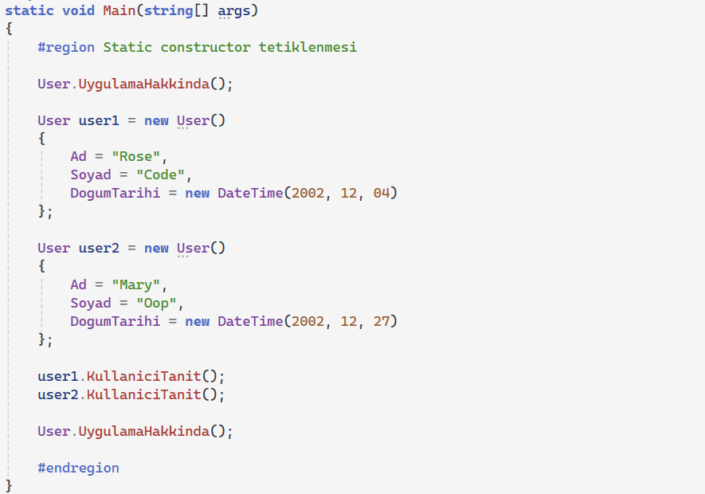
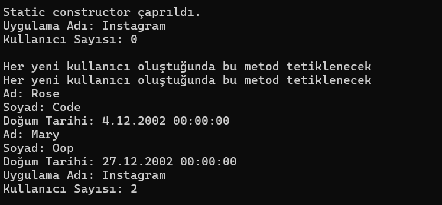

# Static Constructor

## Static Constructor Özellikleri

- Sýnýf içerisinde tanýmlanýrlar.
- Static Constructor özünde bir metottur ve metodun adý sýnýf adýyla ayný olmalýdýr.
- Parametre almazlar.
- Normal Constructor gibi overload olmazlar yani sýnýf içinde yalnýz bir kez tanýmlanabilir.

## Ne Zaman Tetiklenir?

- Static Constructor, sýnýf üyelerine yani static üyelere eriþildiðinde ya da ilgili sýnýftan bir nesne oluþtuðunda birkereliðine mahsus tetiklenir.
- Nesne oluþma iþlemi n kez tekrar etse de birdaha static constructor tetiklenmez.

## Örnek

```Nesne oluþturma
new User();
```

Yeni bir User nesnesi oluþturalým. Görüldüðü gibi nesne oluþturmak için referansa gerek yok :)

## Nesne Oluþurken Sýra

1. Ýlk olarak çalýþma zamanýnda oluþacak olan nesnenin sýnýfýnýn yüklenip yüklenmediðine bakýlýr. 
2. Sýnýfýn ilk kullanýmýnda CLR sýnýfý baþlatýr ve static constructor çalýþýr.
3. Sýnýf yüklenmesinin ardýndan `new` operatörü görülür ve ilgili nesneye **HEAP**'te yer ayrýlýr.
4. Ardýndan nesnenin Constructor'ý tetiklenir ve nesne oluþur.


## Örnek





- Çýktý Açýklamasý:
- Sýnýf içinden static bir üye olan UygulamaHakkinda() metodu çaðrýldýðý için static constructor burada tetiklenip çalýþacaktýr.
- Ardýndan yeni bir nesne oluþurken nesnenin ilgili sýnýfý yüklendiði için static constructor tetiklenmeyecek instance constructor tetiklenecek.
- Baþka bir nesne oluþumunda da instance constructor tetiklenecek zaten bu constructor her nesne oluþumunda tetiklenmek zorundadýr.
