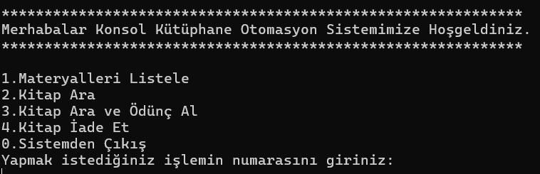
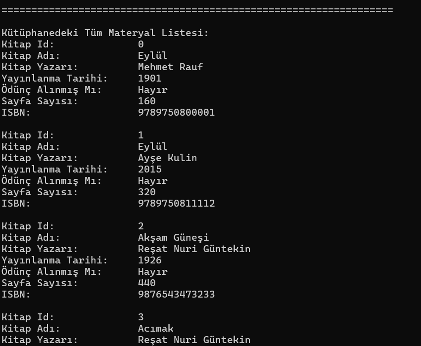
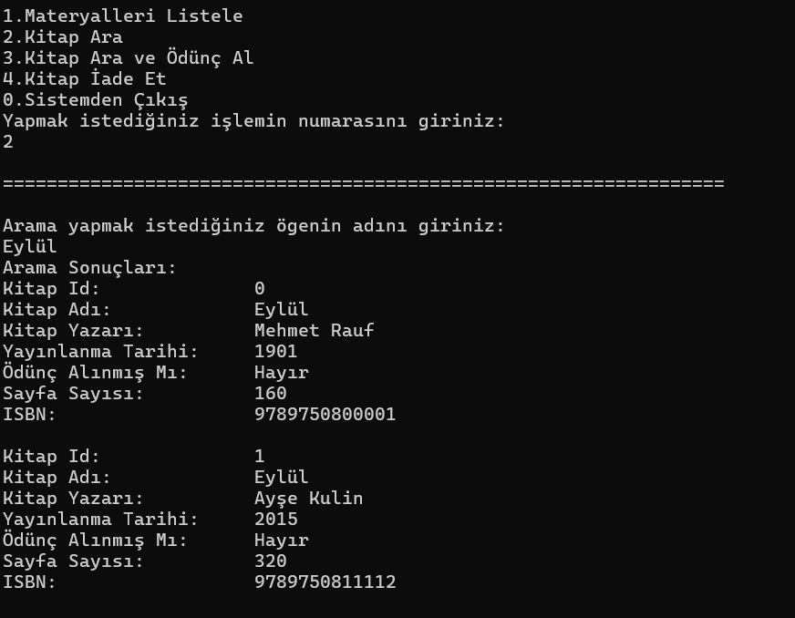
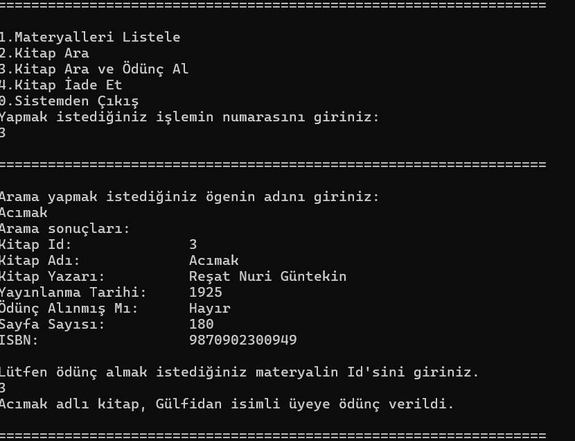
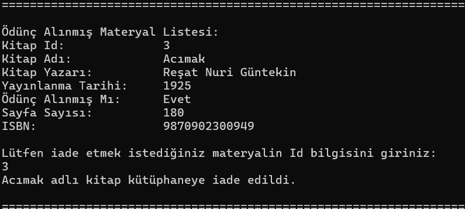

# 🖤 C# Console Library Management System
### Nesne Yönelimli Programlama (OOP) & Polimorfizm Konsol Otomasyonu

## 💜 Proje Hakkında
Bu proje; gerçek dünya kütüphane süreçlerini dijitalleştirmek, Clean Code (Temiz Kod) standartlarını uygulamak ve C# dilindeki ileri düzey OOP yeteneklerini (Soyutlama, Kalıtım, Çok Biçimlilik) pratik etmek amacıyla geliştirilmiş uçtan uca konsol tabanlı bir otomasyon sistemidir.

## 💚 Mimari ve OOP Özellikleri

| Tasarım Deseni / Prensip | Uygulama Alanı | Açıklama |
| :--- | :--- | :--- |
| **Abstract Class** | `LibraryItem` | Doğrudan nesnesi üretilemeyen, tüm materyallerin ortak atası olan soyut sınıf. |
| **Interfaces** | `ISearchable`, `IBorrowable` | Materyallere arama ve ödünç alınıp/iade edilme yeteneklerini kazandıran sözleşmeler. |
| **Polymorphism** | `DisplayInfo()`, `ReturnItem()` | Aynı referans üzerinden farklı alt sınıf davranışlarının (Book, AudioBook) tetiklenmesi. |
| **Encapsulation** | Property'ler (`get/set`) | Veri güvenliği ve kontrollü erişim mekanizmaları. |

---

## ❤️ Desteklenen Materyal Türleri ve Özellikleri

* **📖 Kitap (Book):** Sayfa sayısı, ISBN numarası ve yazar bilgisi.
* **🎧 Sesli Kitap (AudioBook):** Süre bilgisi (otomatik saat/dakika hesaplama mantığı ile).

---

## 🏆 Öne Çıkan Kullanıcı Deneyimi  Özellikleri

* **İnteraktif Döngü:** Sonsuz `while` döngüsü ve `switch-case` yapısıyla çalışan kolay menü sistemi.
* **Gelişmiş Arama & Filtreleme:** Materyalleri ada göre esnek bir şekilde arama ve sadece ödünç alınmış/rafta olan öğeleri filtreleme.
* **Ödünç Alma ve İade Mekanizması:** Üye bazlı kiralama takibi, aynı kitabın tekrar kiralanmasını engelleyen koruma yapıları ve dinamik iade süreçleri.

## 🖥️ Örnek Konsol Çıktıları

Uygulamanın çalıştırılması ve akış senaryolarına ait ekran görüntüleri:

### 1. Menü Çıktısı

  

### 2. Tüm Materyalleri Listele

  

### 3. Arama Sonucu Materyal Listele

  

### 4. Materyal Ödünç Alma

  

### 5. Materyal İade Etme

  

